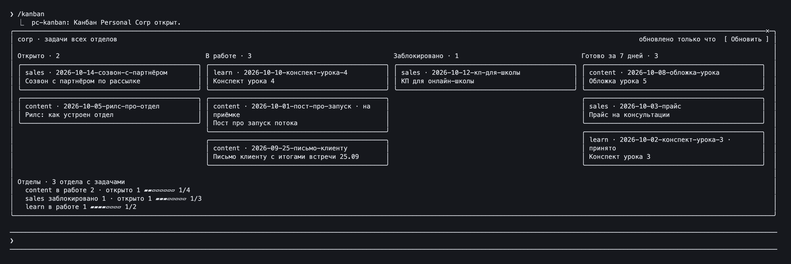

# pc-kanban

[](README.md)
[](README.ru.md)

Мод Claude Code для Personal Corp. При старте сессии он открывает панель: задачи в четырёх колонках по статусам, под ними соседние отделы с полосой прогресса. Клик по карточке кладёт в поле ввода «Возьми в работу …». Команда `/kanban` открывает панель снова.



*Сессия в терминале, штаб ученика. В штабе своих задач нет, поэтому доска собирает task-файлы всех отделов.*

## Два источника задач

| Источник | Где живут задачи | Доска | Под доской |
|---|---|---|---|
| `bd` | граф бидов репозитория (`.beads/`) | биды папки сессии: открыто, в работе, заблокировано, готово за 7 дней | открытые эпики соседних репозиториев с `.beads`, полоса по закрытым детям |
| task-файлы | `tasks/*.md` в папках отделов, файл на задачу | task-файлы папки сессии; в штабе без своих задач — задачи всех отделов | отделы с task-файлами, полоса по закрытым задачам |

Источник выбирает настройка `source`: `auto` (по умолчанию), `bd` или `tasks`. `auto` берёт `bd`, если в папке сессии есть `.beads`; task-файлы, если есть `tasks/`; иначе `bd`, если `.beads` есть у соседей; во всех остальных случаях task-файлы.

## Task-файлы

Формат тот же, что в уроках Personal Corp и в [`templates/department/tasks/_template.md`](../../templates/department/tasks/_template.md):

```markdown
# Письмо клиенту с итогами встречи 25.09

Статус: в работе

## Результат

Черновик письма клиенту: три договорённости со встречи и срок следующего шага.
```

- Задача — файл `tasks/<имя>.md` со строкой статуса: `Статус: …`, `- Статус: …`, `**Статус:** …` или `Status: …`. Файлы без неё (файлы дня, ретро) пропускаются, как и `README.md`, `_template.md` и скрытые файлы.
- На карточке первый заголовок `#` и имя файла.
- Колонку выбирают первые слова статуса; текст после тире или запятой считается пояснением.

| Колонка | Статусы |
|---|---|
| Открыто | `новая` и любое незнакомое панели слово |
| В работе | `в работе`, `на приёмке`, `на проверке` |
| Заблокировано | `заблокирована` |
| Готово за 7 дней | `завершена`, `принято`, `снята`, `готово`; дата из строки `Завершена:` или время правки файла |

Статус, который колонка называет иначе, остаётся на карточке: `на приёмке`, `снята`, `принято`.

Клик кладёт в поле ввода `Возьми в работу задачу ../content/tasks/<файл>.md: <заголовок>`, путь считается от папки сессии. В режиме `bd` — `Возьми в работу бид <id>: <заголовок>`.

## Отделы

Отделы — папки рядом с папкой сессии или внутри настройки `root`. Если в папке сессии лежит `hq/`, сессию открыли над штабом, и корнем считается она сама. Worktree (где `.git` — файл) повторяет соседа и пропускается. В режиме `bd` считаются только git-репозитории с `.beads`.

## Установка

Мод — отдельный плагин в маркетплейсе `personal-corp-os`, только для Claude Code. В терминале:

```bash
claude plugin marketplace add serejaris/personal-corp-os
claude plugin install pc-kanban@personal-corp-os
```

Или в поле ввода Claude Code в терминале, когда маркетплейс уже добавлен:

```text
/plugin install pc-kanban@personal-corp-os
```

Без маркетплейса одна строка добавит его и поставит мод:

```text
/plugin install pc-kanban --marketplace serejaris/personal-corp-os
```

При установке откроется экран настроек; значения по умолчанию подходят. Для десктопного приложения Claude поставьте мод из терминала в область пользователя (команды выше): панель откроется и в сессиях вкладки Code.

## Настройки

| Настройка | По умолчанию | Что делает |
|---|---|---|
| `source` | `auto` | источник задач: `auto`, `bd`, `tasks` |
| `root` | пусто | папка со штабом и отделами; пусто — папка над папкой сессии (`~` понимается) |
| `bd` | `bd` | путь к `bd`, если его нет в `PATH` |
| `autoOpen` | `true` | открывать панель при старте сессии |

Поменять: `/plugin configure pc-kanban@personal-corp-os`.

## Ограничения

- Стартовый экран приложения до начала сессии мод изменить не может, поэтому это панель.
- В терминале уже 144 колонок панель, открытая при старте, ждёт; `/kanban` открывает её при любой ширине.
- В `claude -p` панель рисовать некому, и доска не читается, пока не попросят `/kanban`.
- Режим `bd` вызывает `bd list` в папке сессии и `bd epic status` в каждом соседе с `.beads`, по восемь сразу.

## Разработка

```bash
claude plugin validate plugins/pc-kanban
claude plugin test plugins/pc-kanban
claude --plugin-dir plugins/pc-kanban
```

Тесты гоняют оба источника на файловой системе в памяти (`tests/kit.ts`) и подставном `bd`. API функциональных хуков в раннем доступе: проверено на Claude Code 2.1.301 и 2.1.304.
